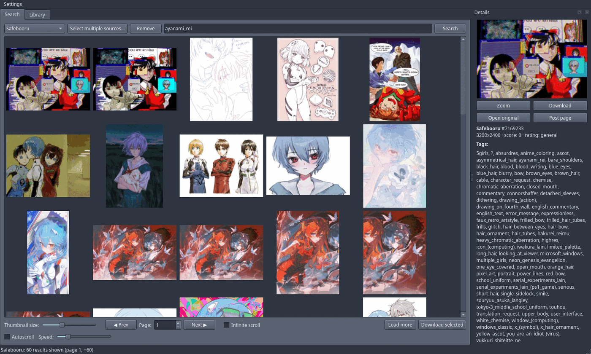
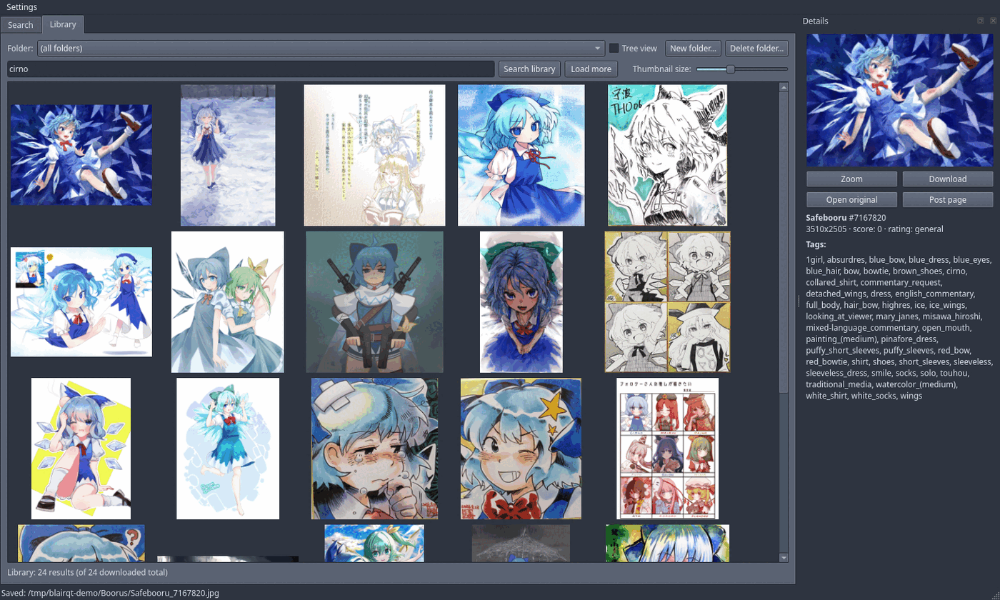

# B.LAIR_QT

*The name B.LAIR stands for (Booru) Local Archive & Indexing Repository.
The `_QT` is not the toolkit — it stands for Cute, which happens to be how
the toolkit is pronounced anyway.*

A desktop booru client. Qt6, C++, no Electron.

B.LAIR_QT is native software for browsing boorus with a local gallery. What
separates it from other booru clients is that the gallery acts as the booru
repository itself: it respects source and tags, and lives in ordinary folders
your Linux file manager already understands.

It searches several boorus at once and downloads the originals; tags go into a
SQLite index next to the files. Delete the database and the files are still
there, still sorted, still openable by anything else on the system.

Boorus that are not on the list are usually one URL away: the app probes the
site against six engines and picks the one that fits. Anything else takes a
short Python plugin — or, for sites with no API at all, the bundled
HTML-scrape bridge.

What it does not do: play video, log into accounts, upload anything, or
sandbox plugins.





## Quickstart

Prebuilt packages are attached to each
[release on GitHub](https://github.com/Re-V0/Booruqt/releases). Download the
one for your system, then (with the version you downloaded):

```bash
sudo pacman -U blairqt-<version>-1-x86_64.pkg.tar.zst      # Arch
sudo apt install ./blairqt_<version>-debian13_amd64.deb     # Debian 13
sudo apt install ./blairqt_<version>-ubuntu26.04_amd64.deb  # Ubuntu 26.04 (or -ubuntu24.04)
sudo pkg add blairqt-<version>-freebsd15-amd64.pkg          # FreeBSD 15 (or -freebsd14)
```

Windows (64-bit): unpack `blairqt-<version>-windows-x64.zip` anywhere and run
`blairqt.exe`. Nothing is installed; settings and the library index live in
your user profile.

macOS (Apple Silicon): open `blairqt-<version>-macos-arm64.dmg` and drag
B.LAIR_QT to Applications. The app is not signed with an Apple Developer ID,
so the first start is blocked: open System Settings → Privacy & Security and
click "Open Anyway" next to B.LAIR_QT.

Python plugins need Python 3: `python3` or `python` on PATH, or on Windows
the `py` launcher from python.org. Set `BLAIRQT_PYTHON` to an interpreter's
full path to use a different one.

Arch Linux, from source. Build outside the source tree: makepkg keeps its
sources in `./src`, the same name as this project's source folder, and
`makepkg -c` would delete it.

```bash
mkdir -p ~/build/blairqt
cp PKGBUILD ~/build/blairqt/
cd ~/build/blairqt
makepkg -si
```

Gentoo — drop the ebuild into a local overlay:

```bash
mkdir -p /var/db/repos/local/media-gfx/blairqt
cp blairqt-0.3.1.ebuild /var/db/repos/local/media-gfx/blairqt/
ebuild /var/db/repos/local/media-gfx/blairqt/blairqt-0.3.1.ebuild manifest
emerge -av media-gfx/blairqt
```

`blairqt-9999.ebuild` builds from git master instead. `USE=python` pulls an
interpreter for script plugins; `USE=test` runs the suite during the merge.

Anything else — needs Qt 6 (Widgets, Network, Concurrent, Sql,
LinguistTools), CMake 3.21+ and a C++20 compiler:

```bash
cmake -S . -B build -G Ninja -DCMAKE_BUILD_TYPE=Release
cmake --build build
./build/blairqt
```

On first start a welcome screen asks which sources to load. Nothing explicit
is enabled unless you pick it. Type tags, hit Enter, drag the slider if the
thumbnails are the wrong size. Right-click a post to download it or to
blacklist a tag.

## Sources

Six generic parsers — Danbooru, Gelbooru/dapi, Moebooru, e621, Philomena,
Szurubooru — cover dozens of sites without a class per site. **Add custom
booru** probes a URL and works out which one fits.

Several sources can be merged into one gallery. Paging, infinite scroll and
autoscroll are three ways to move through results; picking one disables the
controls that stop making sense.

Cloudflare-gated Gelbooru sites accept a cookie and User-Agent you paste in.
Sites with no API at all can go through the bundled HTML-scrape bridge — those
posts arrive without tags, rating or dimensions, which is the price of
scraping HTML.

Every request, status code and response snippet lands in the network log dock.
When a site misbehaves, that dock is the first place to look.

## Library

Downloads are indexed in SQLite with an FTS5 tag index and written into real
nested folders — the same folders Dolphin or Thunar show. Move files between
them from inside the app and the tags follow; re-downloading a post you
already have is detected and skipped.

Each image also gets a hidden tags sidecar next to it — `image.png` gets
`.image.png.txt`, one line of space-separated tags. It follows the file when
you move it, and it is what lets another tool (or you, with `grep`) read the
tags without touching the database. The metadata is stored as `.txt` as well,
because why not — txt is cheap.

Search the library by tag, filter by folder, with or without subfolders.
Zoom opens local files instantly, animated GIFs included.

## Blacklist

A tag blacklist, global or per source, editable in Settings or straight from a
post's context menu. Sites that understand `-tag` get the exclusions pushed
into the query; the rest are filtered before they reach the grid.

Matching is exact: `solo` does not hide `solo_focus`. It can apply to the
library too, if you want the same rules on what you already downloaded.

## Plugins

A new booru engine is one Python file. No C++, no rebuild:

```python
def build_search_request(base_url, tags, page, per_page) -> dict:
    """Return {"url": ..., "headers": {...}}."""

def parse_response(body, base_url) -> list[dict]:
    """Return post dicts: id, file_url, preview_url, sample_url,
    post_page_url, tags (list), rating, score, width, height."""

def supports_tag_exclusion() -> bool:      # optional
    """True if the site understands "-tag", so the blacklist can be applied
    in the query instead of only filtering the results. Defaults to False."""
```

Add it through **Add custom booru** → *Plugin script*; with Auto-detect on, the
script is tried automatically. Tracebacks show up in the dialog log and the
network log dock. Plugins need `python3` on `PATH`, and some need their own
modules — the Newgrounds example in
[`examples/`](examples/newgrounds_plugin.py) wants `argon2-cffi`.

**Plugins run with your full user permissions. Only add scripts you trust.**

## HTML-scrape bridge

For Gelbooru-engine sites with no `dapi`. Not started automatically:

```bash
pip install flask cloudscraper beautifulsoup4
python3 tools/html_scrape_bridge.py
```

It listens on `127.0.0.1:8765`. Tick *This site has no API (dapi)* when adding
the source.

## Appearance and language

Themes are JSON over `QPalette`; 20 curated ones ship with the app and the
system default is one click away. Interface languages: Polish, English,
German, Danish, Russian, following the system language when it is one of
those. Window and dock layout survive a restart.

## Safety

The app writes inside its own data folder and folders you explicitly grant,
and nowhere else. That is application discipline, not a sandbox — a plugin you
add runs as you do. Stored API keys and cookies (`custom_sources.json`) are
written owner-only (0600).

## Tests

No network, no visible window:

```bash
ctest --test-dir build --output-on-failure
```

They cover blacklist matching, tag input, response parsing, library paging and
the rule that a plugin never blocks the GUI thread.

## Data locations

- Settings: `~/.config/blairqt/blairqt.conf`
- Library DB, sources, theme: `~/.local/share/blairqt/blairqt/`
- Thumbnail cache: `~/.cache/blairqt/`

## Contributing

Issues and merge requests are welcome. Before sending a patch, run the tests —
they take a second and need no network and no display:

```bash
ctest --test-dir build --output-on-failure
```

### Windows port

Welcome, and I will merge it. I do not run Windows, so testing it is yours.

The code does not stand in the way. There are no POSIX calls anywhere,
everything goes through Qt, and the binary already looks for its translations
and `plugin_runner.py` next to itself — so a portable layout (`blairqt.exe`
beside `translations\` and `plugin_runner.py`) works with no changes at all.

What is left to do:

- resolve `python3` to whatever Python is called there (`python.exe`, or the
  `py -3` launcher),
- hide the tag sidecars — a leading dot hides nothing on Windows, so every
  image would get a visible `.txt` neighbour,
- bundle the Qt DLLs with `windeployqt` and ship a zip or an installer.

## Support

Buy me a Linux license — the evil GNU charges me $70 per install:
[buymeacoffee.com/re_v0](https://buymeacoffee.com/re_v0)

## License

Copyright (c) 2026 re-v0. Mozilla Public License 2.0 — see [LICENSE](LICENSE),
which is the unmodified Mozilla text.

MPL copyleft is per file: you may combine these files with code under another
license, but modifications to the files themselves stay MPL and stay open.

**Trademarks.** Qt is a registered trademark of The Qt Company Ltd. B.LAIR_QT
is an independent project and is neither affiliated with nor endorsed by The
Qt Company. It links the Qt 6 libraries dynamically under the LGPL-3.0; those
libraries are not bundled, and replacing them with your own build is both
allowed and expected.
